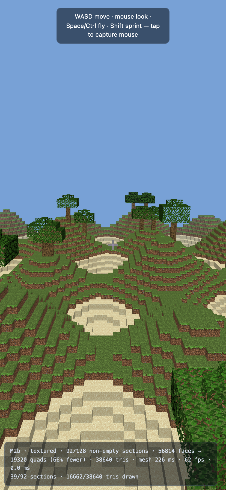
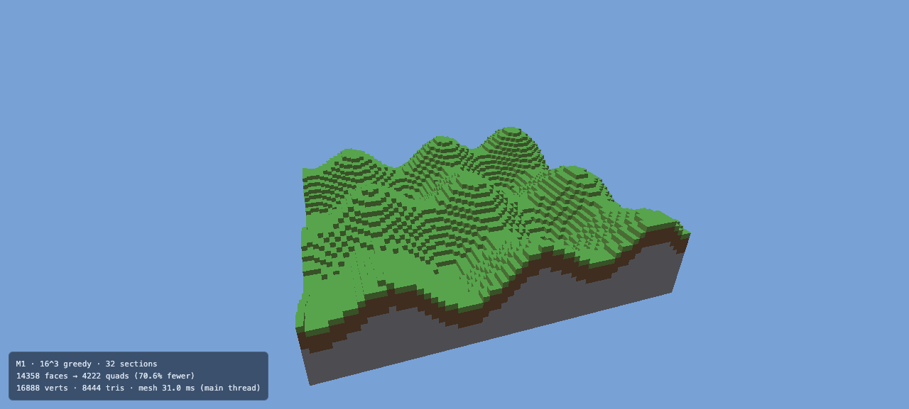
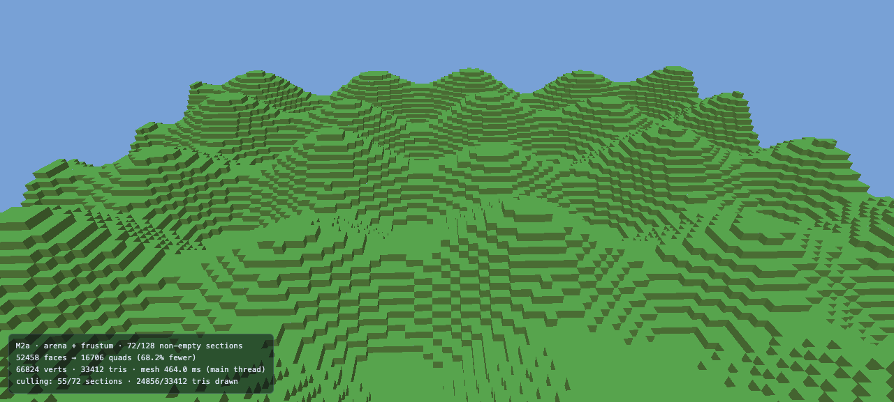
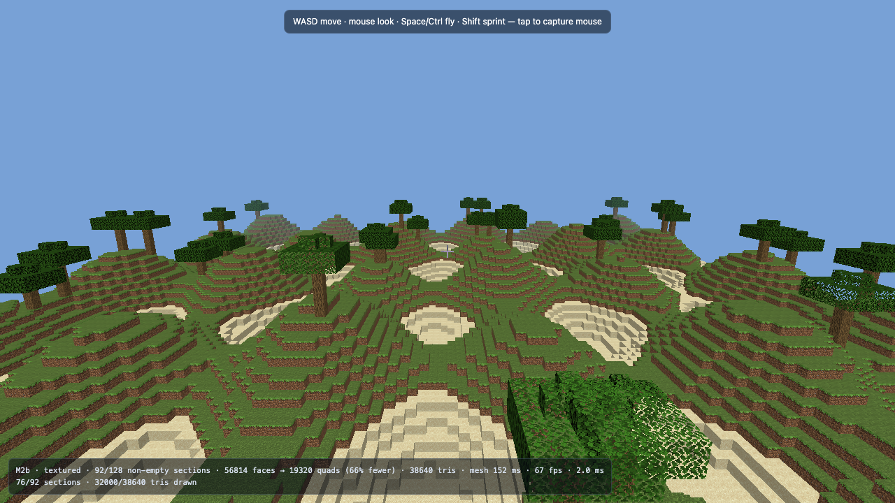

# The Zombie Hybrid — Body renderer (`renderer/`)

Status: **Milestone 2b complete** (Oct 27 2026). The Body now draws the client jar's own
block textures through a 99-layer texture array, with vanilla face shading, sky colour and
distance fog, on top of M2a's persistent arena and frustum culling. Meshing is 56,814 faces →
19,320 quads (66 % fewer) / 38,640 triangles across 92 non-empty sections, and block edits
re-mesh incrementally inside a 3 ms/frame budget. A free-fly camera (touch, mouse, keyboard)
replace the orbit. Startup meshing is still one synchronous 0.12–0.25 s pass; the Worker moves
to M2c.



## 1. Principle

- **Brain (Java) is the only simulation.** World generation, the 20 TPS tick, player
  movement, gravity, collision, friction, boats, redstone and mods stay in Java. The
  Brain reports *state* (block IDs, camera pose, entity transforms) and never asks the
  Body to compute gameplay.
- **Body (Rust) is a dumb, fast renderer.** It receives snapshots, meshes them greedily,
  culls, uploads and draws. If the Body ever "fixes up" a position, sprint-jump distance,
  ice friction or boat momentum will drift from Java — that is a bug by definition.
- **Shaders and mods come last** (per project decision). This crate must not block them:
  keep pipeline construction data-driven and leave room for extra render passes.

## 2. Repo reality (important)

The Java client is compiled by TeaVM to JavaScript (not WASM): `ClientMain`
calls Mojang's real `net.minecraft.client.main.Main`. The browser port does not
pretend that a graphics context exists. It routes renderpearl's preferred backend
to the custom WebGPU implementation (`GraphicsPatches` /
`WebGpuBackend`), creates an SDL-compatible DOM canvas, and redirects the
Vulkan feature-table bootstrap away from LWJGL's Vulkan structs
(`patches/rules.txt`). The Java brain runs in an off-screen iframe in the hybrid
page; `web/bridge.js` forwards its real client-level section snapshots to the
Rust Body in the parent page.

The old `VkPhysicalDeviceFeatures2 … required member null` note above was the
historical blocker that motivated those targeted patches; it is not proof that
the current code still fails there. The dedicated CI workflow
`verify-client-browser.yml` now builds the actual `ClientMain`, builds the Rust
WebGPU Body, launches an isolated singleplayer smoke world, and waits for a real
Java section to reach the Rust bridge. Until that browser workflow passes, do
not treat world generation or Java-to-Rust delivery as verified.

Consequences:

- The Body crate below is developed **standalone** and does not depend on the Brain
  packaging. It can be verified with the triangle + synthetic sections today.
- The eventual Brain packaging for mobile must be a WASM build (TeaVM WASM-GC target or
  another Java→wasm path) plus aggressive reachability trimming. A 279 MB JS bundle cannot
  ship under Safari's ~1.4–1.5 GB tab limit. That is a separate workstream.
- The old JS WebGPU bridge (`web/gpu/`) stays untouched for now; the Rust Body will
  replace it once M3 lands.

## 3. Layout

```
renderer/
├── Cargo.toml            # wgpu 30, wasm-bindgen, web-sys; cdylib
├── index.html            # harness only: init() + run(); no rendering JS
├── .gitignore
└── src/
    ├── lib.rs            # surface/device, chunk pipeline, depth, camera, RAF, stats
    ├── bridge.rs         # section store, upload_section export, synthetic world
    ├── arena.rs          # vertex/index arena + per-section draw ranges
    ├── cull.rs           # frustum planes + section AABB test
    ├── mesh.rs           # 18³ border assembly + 16³ greedy mesher
    ├── math.rs           # column-major perspective / look_at / multiply
    └── shader.wgsl       # chunk shader (camera uniform, vertex color/normal)
```

Planned (created as each milestone starts, not before):

```
    ├── material.rs       # block-state -> atlas layer / flags table
    └── worker.rs         # mesh worker + transferables (M2b)
```

## 4. Bootstrap and M1 wiring

### 4.1 M0 — surface bootstrap (verified)

`src/lib.rs`:

- Finds `#mc-canvas`, sizes the drawing buffer at `client size × min(dpr, 2)`.
- Creates `wgpu::Instance` with `Backends::BROWSER_WEBGPU`, a `SurfaceTarget::Canvas`,
  requests a `LowPower` adapter, then a device with minimal limits
  (`downlevel_webgl2_defaults().using_resolution(adapter.limits())`).
- Surface config: `PresentMode::Fifo`, `desired_maximum_frame_latency = 2`.
- Builds a triangle pipeline (no vertex buffer, positions from `vertex_index`) and runs a
  `requestAnimationFrame` loop entirely in Rust. Handles
  `CurrentSurfaceTexture::{Success, Timeout, Occluded, Suboptimal, Outdated, Lost, Validation}`.
- Reconfigures on CSS-size changes (orientation, Safari chrome collapse) and recreates the
  surface on `Lost`.

The HTML page is harness glue only: `await init(); run();`.


### 4.2 M1 — synthetic chunk path (verified)

- `bridge::generate_demo()` fills 32 stored sections (4×4 chunks, 2 layers) with a sine
  heightmap: stone below, four layers of dirt, grass on top. 15 of the top-layer sections
  are fully air, so only 17 contain geometry.
- `mesh.rs` assembles an **18³ padded volume** from the center section plus its six
  neighbours (missing = air), then greedily merges visible faces per axis and direction.
  M1 treats every non-air ID as opaque; the material handshake comes later.
- The vertex is 36 bytes (`position f32×3`, `normal f32×3`, `color f32×3`). All sections
  are baked into one vertex/index buffer and drawn with a single `draw_indexed`, depth-tested
  against `Depth32Float`. Back-face culling stays off in M1 because only visible faces are
  emitted; enabling it is part of M2.
- An orbiting camera supplies one 64-byte `mat4x4<f32>` uniform. Stats are written to
  `#stats` and the console — no JavaScript rendering logic.
- The bridge export is live: `upload_section(...) -> bool` accepts a 4096-element
  `Int32Array` and rejects wrong sizes. Verified from page JS: a good-length upload returns
  `true`, a 10-element upload returns `false`.

Measured (headless Chrome 155, desktop GPU, release wasm):

| Metric | Result |
| --- | --- |
| Stored / non-empty sections | 32 / 17 |
| Visible faces (naive quads) | 14,358 |
| Greedy quads | 4,222 |
| Quad reduction | 70.6 % |
| Vertices / triangles | 16,888 / 8,444 |
| Mesh time, all 32 stored sections | 26–31 ms (main thread) |
| Body wasm | 187 KB post-bindgen |

The ~90 % target is not reached on this hilly island: staircase side faces are mostly one
block deep and cannot merge. Flat terrain does much better. The 26–31 ms total is roughly
0.8–1.0 ms per 16³ section; the next wins are packing vertices to ~16 bytes and meshing in
a Worker so this stall never reaches the render loop.



### 4.3 M2a — arena + frustum culling (verified)

- The demo world is now 8×8 chunks (128×128 blocks): 128 stored sections, 72 non-empty.
  The arena skips the 56 all-air sections, so it only holds drawable geometry.
- `arena.rs` packs all section meshes into one vertex buffer and one index buffer. Every
  section records an index range and a world AABB; the render loop issues one `draw_indexed`
  per surviving section. The arena is uploaded once at startup; incremental remeshing writes
  are M2b.
- `cull.rs` extracts the six Gribb–Hartmann planes from the view-projection matrix and tests
  each section AABB against the positive vertex. The test is conservative (a section is
  drawn if any part of its 16³ box intersects the frustum).
- Back-face culling is enabled after checking the emitted winding; the terrain renders
  watertight. The camera is a render-only orbit placed inside the island; it is not
  simulation and will be replaced by the Java camera pose in M3.
- Fixed an M1 camera bug: the orbit angle used epoch milliseconds in `f32`, which quantised
  so coarsely that the motion would jitter. It now subtracts a start timestamp first.
- The iPhone check uses CDP device emulation (414×896 CSS, dpr 2 → 828×1792 canvas), not a
  desktop window. `scripts/cdp.py --viewport` drives it.

Measured (headless Chrome 155, desktop GPU, release wasm):

| Metric | Result |
| --- | --- |
| Stored / non-empty sections | 128 / 72 |
| Visible faces → greedy quads | 52,458 → 16,706 (68.2 % fewer) |
| Vertices / triangles | 66,824 / 33,412 |
| Culled, iPhone 414×896 | 51/72 sections, 23,068/33,412 tris (69 %) |
| Culled, desktop 1280×577 | 17/72 sections, 8,556/33,412 tris (26 %) |
| Mesh time, all stored sections | 0.19–0.46 s (main thread, run variance) |
| Body wasm | 190 KB post-bindgen |

Frustum culling is strongly aspect-dependent: the phone's narrow horizontal FOV rejects most
of the island, while the wide desktop viewport sees most of it. This is expected; occlusion
culling (a later step) addresses the sections that are in-frustum but behind hills. The
startup mesh stall is the remaining red flag for a 60 fps main thread — M2b moves meshing to
a Worker.



### 4.4 M2b — vanilla textures, shading, fog, camera (verified)

The Body stopped inventing colours and now samples the same pixels the Java client does.

- **Texture array, not an atlas.** `client-resources.bin` carries the vanilla block PNGs
  from the user's own 26.3 jar; `renderer/index.html` hands each one to
  `upload_texture(layer, bytes)` and Rust decodes it (`png` crate), resamples to 16×16,
  builds a 4-level mip chain and copies it into one `texture_2d_array` of 16 layers. An
  array is what makes greedy merging legal: a merged 5×3 quad still repeats the 16×16 tile
  through `Repeat` addressing, exactly like vanilla repeats a block face.
  Animated textures (water, lava, fire) contribute their first frame.
- **Vanilla materials.** `material.rs` maps block IDs to a layer plus the vanilla flags, and
  carries the classic directional shade table — up 1.0, north/south 0.8, east/west 0.6,
  down 0.5 — so terrain reads the same as Java before any lightmap exists. Cutout uses
  vanilla's `alpha > 0.1` test rather than 0.5, which keeps mip-mapped leaves from
  dissolving at distance.
- **Biome tint.** Modern vanilla bakes grass and foliage as greyscale and tints at runtime;
  the Body does the same at upload time (plains `#91BD59` grass, `#59AE30` foliage) instead
  of paying a per-pixel tint in the fragment shader.
- **Sky and fog.** Clear colour is the vanilla overworld horizon blue; the fragment shader
  blends to it with `smoothstep(fog_start, fog_end, distance)`. Both live in the camera
  uniform, so M3's Java camera can move them without a rebuild.
- **Packed vertices.** 28 bytes per vertex: `pos: 3×f32`, `uv: 2×f32` (world-aligned, so a
  merged quad's UVs run past 1.0 and repeat), `layer: u32`, `shade: u32`.
- **sRGB correction (a real bug, now understood).** The first textured build looked about
  half as bright as Java. Cause: the block PNGs are sRGB, so sampling them through an
  `Rgba8UnormSrgb` texture linearises them, and WebGPU canvas contexts only accept
  `bgra8unorm` (there is no sRGB swap chain on the web), so those linear values got written
  out as if they were sRGB. Fix: keep the texture array `Rgba8Unorm` and do the lighting
  maths in sRGB space — which is what Java Minecraft does anyway.
- **Free-fly camera.** Touch (left half drag = move, right half = look, two fingers = fly),
  mouse capture and WASD/Space/Shift are debug-only. M3 replaces it with the Java pose;
  it must never grow physics.

Demo world: 8×8 chunks × 2 layers, heightmap with sand at sea level, snow on peaks, stone
with ore pockets, and trees. It exists only to exercise the mesher and materials.



Measured (headless Chrome 155, desktop GPU, release wasm):

| Metric | Result |
| --- | --- |
| Stored / non-empty sections | 128 / 92 |
| Visible faces → greedy quads | 56,814 → 19,320 (66 % fewer) |
| Vertices / triangles | 77,280 / 38,640 |
| Drawn, iPhone 414×896 dpr 2 | 39/92 sections, 16,662/38,640 tris, 62 fps |
| Drawn, desktop 1280×720 | 76/92 sections, 32,000/38,640 tris, 67–167 fps |
| Mesh time, all stored sections | 0.12–0.25 s (one synchronous startup pass) |
| Incremental re-mesh budget | ≤ 4 sections and ≤ 3 ms per frame |
| Body wasm | 315 KB post-bindgen |

The frame rate spread is run-to-run noise on a shared machine, not a device measurement; the
iPhone 11 and 2017 MacBook Air numbers still have to come off real hardware.

## 5. Bridge: Int32Array block IDs → mesh

There is **no JNI in WebAssembly**. The "bridge" is wasm-bindgen imports/exports plus
typed-array views over linear memory (or a SharedArrayBuffer). Two integration eras:

- **Today (TeaVM → JS Brain):** JS glue passes typed arrays to the Rust module.
- **Later (TeaVM WASM-GC Brain):** both sides are wasm, but cross-module calls still go
  through JS glue; shared `ArrayBuffer`/SAB remains the zero-copy path.

### 5.1 Section snapshot

- Unit: one **16×16×16 section** (`cx, cy, cz` in section coordinates, `cy = worldY >> 4`).
- Payload: `Int32Array(4096)`, index `= y*256 + z*16 + x` (y up), value = global
  block-state ID, `0` = air. IDs come from Java's registry, so the Body never interprets
  block names.
- `version` (u32, monotonic per section): worker results with an older version are dropped.
- 16 KB per section. Sending only dirty sections per tick is negligible bandwidth.

### 5.2 Transport

- **v0 (works with today's JS Brain):** copy in.
  ```rust
  #[wasm_bindgen]
  pub fn upload_section(cx: i32, cy: i32, cz: i32, version: u32, ids: &[i32]) -> bool;
  ```
  wasm-bindgen copies the typed array into wasm memory once (16 KB) — fine at section
  granularity. Returns `false` when `ids.len() != 4096`. Never send whole chunks per frame;
  only deltas.
- **v1 (zero-copy):** enable COOP/COEP (`Cross-Origin-Opener-Policy: same-origin`,
  `Cross-Origin-Embedder-Policy: require-corp`) so `SharedArrayBuffer` exists; Java writes
  IDs into a SAB ring and Rust reads it directly through a `js_sys::Int32Array` view while
  meshing. Alternative: Rust exports a scratch pointer and JS writes into a
  `Uint32Array(wasm.memory.buffer, ptr, len)` view — re-create views after any wasm memory
  growth.

### 5.3 Meshing job (Rust)

1. Snapshot enters a queue tagged `(cx, cy, cz, version)`.
2. A mesh worker (2 workers on an A13; `navigator.hardwareConcurrency` is 6 but Safari
   throttles) assembles an **18³ padded copy** from the section plus its 6 neighbours.
   Missing neighbour → its faces render (they get re-meshed when the neighbour arrives).
3. **Greedy meshing** per axis slice: merge coplanar faces with equal (state, face, light,
   tint) into one quad. This is the ~90 % vertex reduction requirement. Ambient occlusion
   breaks merging where corner AO differs — keep AO disabled in the first pass.
4. Output: packed vertices (~16 bytes target: local pos 5:5:5/6, normal, atlas layer,
   tint/light), `u32` indices, section AABB, face counts. Buffers are **transferable**
   `ArrayBuffer`s posted back to the main thread.

M1 implements only the synchronous core: padded assembly and greedy merging run once at
startup on the main thread, vertices are 36 bytes, and all sections go into one combined
buffer. The queue/Worker, transferables, packed vertices and per-section draw ranges are M2.

### 5.4 Material table (startup handshake)

Java sends `blockStateId -> { atlasLayer, tint, flags }` for every renderable state
(opaque / cutout / translucent, cull rule, light emission). Rust stores a dense
`Vec<Material>` (~27k states in 26.3, under 1 MB). Meshing consults only this table —
no per-block calls into Java.

### 5.5 Per-frame input

- Camera: position + orientation (yaw/pitch) and projection parameters, as a small
  `Float32Array`. Rust derives view/projection matrices; it does not integrate motion.
- Entities: `(entityId, x, y, z, yaw, pitch, scale, modelId)` snapshots for the render tick.
- Partial-tick interpolation is a *render-only* lerp between two states **provided by Java**;
  it never feeds back into simulation.

### 5.6 Upload and draw

- Persistent GPU vertex/index arena. Each section owns a slice; remeshing writes into a
  free/staging range with `queue.write_buffer` and updates the slice's draw range.
  M2a implements the arena, per-section draw ranges and culling; incremental remesh writes
  arrive in M2b.
- No `create_buffer` in the frame loop; no per-frame allocation in Rust.
- Frame: update uniforms → frustum-cull section AABBs (6 planes, Gribb–Hartmann) →
  sky clear → opaque → cutout → translucent (back-to-front) → entities/UI later.
- One draw call per visible section is acceptable (hundreds); indirect drawing is a later
  optimization.

## 6. iPhone 11 memory budget

Safari jetsam kills the tab around ~1.4–1.5 GB; target ≤ 1.2 GB with headroom.

| Component                                   | Budget  |
| ------------------------------------------- | ------- |
| Java/TeaVM heap (world, mods, assets meta)  | 384 MB  |
| Rust wasm linear memory                     | 160 MB  |
| GPU chunk vertex/index arena                | 128 MB  |
| GPU textures (atlas + mips)                 | 64 MB   |
| Framebuffers (828×1792, depth, no MSAA)     | ~48 MB  |
| Mesh-worker scratch                         | 32 MB   |
| Browser/WebGPU overhead                     | ~200 MB |
| Headroom / fragmentation                    | ~180 MB |

Rules: dpr cap 2 (828×1792 ≈ 1.48 MP; dpr 3 would be 3.0 MP), no MSAA, `Fifo` present,
≤ 2 frames in flight, cap Rust heap with `--max-memory` once sizes stabilize.

## 7. Risks / verify on the actual device

1. **WebGPU on iPhone 11 Safari** — iOS 26 Safari ships WebGPU, but confirm
   `navigator.gpu` + adapter on the physical device, and that WebGPU requires a secure
   context (use HTTPS or localhost; a LAN `http.server` will not expose `navigator.gpu`).
2. **WebGPU/OffscreenCanvas inside Workers** — support varies. Default plan: mesh in
   workers, GPU upload/draw on the main thread. Verify before committing to worker-side
   rendering.
3. **Memory** — the current 279 MB JS Brain cannot ship; the budget assumes the WASM Brain
   workstream lands. Watch Safari memory footprint with the Web Inspector on device.
4. **Thermal throttling (A13)** — budget ~8 ms CPU/frame; greedy meshing must run off the
   main thread or be time-sliced.
5. **Iris later** — WebGPU has no geometry shaders or transform feedback; only a subset of
   shader packs can transpile (naga GLSL → WGSL, deferred pass restructure). Deferred by
   decision, but the pass structure stays open for it.
6. **Chunk generation threading** — generation is Brain work (Java), not Body work. Keeping
   the main thread stutter-free needs a Brain-side strategy (a second Java instance in a
   worker, or time-sliced generation). The Body only guarantees that *meshing* never blocks
   the main thread.

## 8. Build & run

Prerequisites:

```sh
rustup target add wasm32-unknown-unknown
cargo install wasm-bindgen-cli --version 0.2.129
```

Build and serve (either toolchain works):

```sh
cd renderer

# Option A: wasm-pack (fetches its own bindgen/wasm-opt)
wasm-pack build --target web --release

# Option B: cargo + wasm-bindgen-cli (version must match Cargo.lock: 0.2.129)
cargo build --release --target wasm32-unknown-unknown
wasm-bindgen --target web --out-dir pkg --out-name mc_body \
  target/wasm32-unknown-unknown/release/mc_body.wasm
# If CARGO_TARGET_DIR is set, read the wasm from
# $CARGO_TARGET_DIR/wasm32-unknown-unknown/release/mc_body.wasm instead.

python3 -m http.server 8080                # open http://localhost:8080
```

Expected: sky-blue background with a depth-tested greedy-meshed island and the `#stats`
overlay (stored/non-empty sections, face/quad reduction, vertex/triangle counts, mesh time,
visible sections/triangles). No JS rendering code. On iPhone, serve over HTTPS (tunnel or
local TLS) so the page is a secure context.

To reproduce the iPhone-sized culling check (CDP device emulation, 414×896 CSS, dpr 2):

```sh
python3 scripts/cdp.py http://127.0.0.1:8080/ --gpu --viewport 414x896 --dpr 2 \
  --until-js "document.getElementById('stats').textContent.includes('culling:')" \
  --screenshot docs/m2-iphone-culling.png
```

Verified Oct 26 2026: release build clean; wasm 190 KB post-bindgen. M1: 14,358 faces →
4,222 quads (70.6 % fewer), 26–31 ms. M2a: 52,458 faces → 16,706 quads (68.2 % fewer);
iPhone viewport 21/72 sections, 10,344/33,412 tris drawn (69 % culled). Bridge test from
page JS returns `true` for a 4096-element section and `false` for a 10-element buffer.

Verified Oct 27 2026 (M2b): 16/16 block textures decode from the client jar; wasm 315 KB;
56,814 faces → 19,320 quads (66 % fewer); `surface format: Bgra8Unorm` logged once at
startup, confirming the raw-sRGB path. Screenshots above are CDP captures of the shipped
`build/web/body.html`.

## 9. Milestones

- **M0** — done: triangle on the WebGPU canvas, resize/lost-surface handling.
- **M1** — done: bridge v0 (`upload_section`), 18³ border assembly, 16³ greedy mesher,
  32-section synthetic island, depth-tested draw, measured 70.6 % fewer quads and 26–31 ms
  mesh time for all sections.
- **M2a** — done: 8×8-chunk synthetic island, persistent per-section arena, six-plane
  frustum culling, back-face culling, iPhone-aspect verification (69 % of triangles culled),
  camera-time precision fix.
- **M2b** — done: real block textures in a 16-layer array, vanilla face shading and tint,
  sky/fog, packed 28-byte vertices, incremental arena re-mesh under a 3 ms budget, free-fly
  debug camera, sRGB output-path fix.
- **M2c** — next: move meshing into Workers with transferables and stale-version drops, so
  the startup pass stops stalling the main thread.
- **M3** — wire to the Java Brain (TeaVM build; transport v0), first real chunks and the
  camera pose supplied by Java.
- **M4** — entities, sky/fog/lightmap, cutout + translucent sorting.
- **M5** — mods (logic stays Java; Body only honours block/entity state).
- **M6** — Iris subset (GLSL→WGSL via naga, shadow/gbuffer/composite passes).
